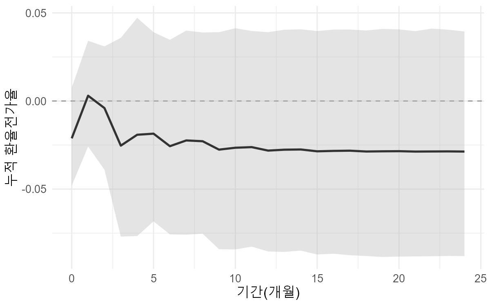
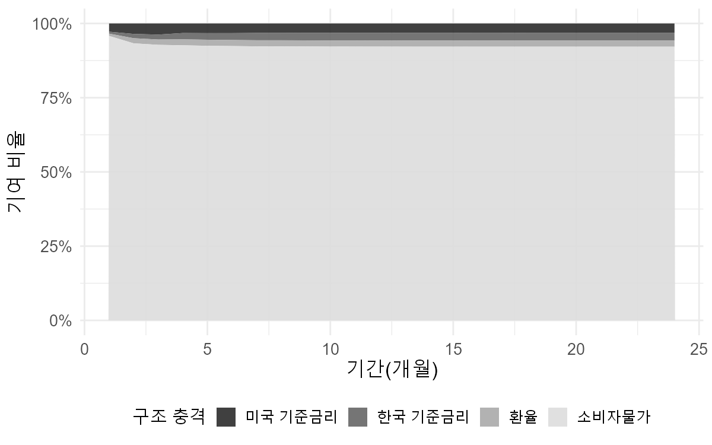
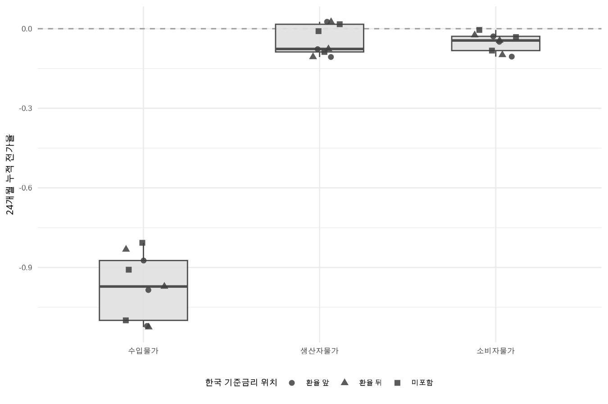

# 명목실효환율 변동에 따른 국내물가 전가도 분석 (SVAR)

**월별 시계열 자료를 이용한 명목실효환율 변동에 따른 국내물가 전가도 분석 — 통계적 구조변화를 고려한 SVAR 접근**

2026년 상반기 3인 공동연구(최종보고서 제출 2026.06.17)의 R 분석 코드입니다.

- 저자: 김대웅 · 방서윤 · 조세연 (국민대학교)
- 분석 기간: 2010.1 ~ 2026.2 월별 (차분 후 분석 표본 2010.2 ~ 2026.2, 193개월)
- 환경: R 4.5.3

---

## 1. 연구 질문

1. 명목실효환율(NEER) 충격은 수입물가 → 생산자물가 → 소비자물가 각 단계에 얼마나 크게, 얼마나 빠르게 전달되는가?
2. 그 결과는 분석자가 정한 모형 구성(통제하는 해외 변수, 한국 기준금리의 식별 순서)에 따라 달라지지 않는가?

첫 번째 질문은 소비자물가 대표 모형(4장·5장)으로, 두 번째 질문은 27개 대안 구성(6장)으로 답합니다.

## 2. 데이터

| 변수 | 정의 | 출처 (계열 코드) | 처리 |
|---|---|---|---|
| 환율 | 한국 명목실효환율 (Broad) | BIS | 로그차분 |
| 수입물가 | 수입물가지수 총지수 | 한국은행 ECOS (401Y015) | X-13 계절조정 → 로그차분 |
| 생산자물가 | 생산자물가지수 총지수 | 한국은행 ECOS (404Y014) | X-13 계절조정 → 로그차분 |
| 소비자물가 | 소비자물가지수 총지수 | 한국은행 ECOS (901Y009) | X-13 계절조정 → 로그차분 |
| 한국 기준금리 | 한국은행 기준금리 | 한국은행 ECOS (722Y001) | 1차차분 (%p) |
| 미국 기준금리 | 연방기금금리 | FRED (FEDFUNDS) | 1차차분 (%p) |
| VIX | 변동성지수, 일별 → 월평균 | FRED (VIXCLS) | 로그차분 |
| 국제유가 | 두바이유 현물가격 | FRED (POILDUBUSDM) | 로그차분 |

원자료는 레포에 포함하지 않습니다. ECOS·FRED는 스크립트가 API로 받아오고, BIS 파일은 직접 내려받아야 합니다 → [data/README.md](data/README.md)

## 3. 분석 절차

| 단계 | 스크립트 | 내용 | 출력 |
|---|---|---|---|
| 1 | `R/01_data_collect.R` | ECOS·FRED API 수집, BIS 엑셀 읽기, 월별 병합 | `df_merged` |
| 2 | `R/02_preprocess.R` | 물가 3종 X-13ARIMA-SEATS 계절조정 → 로그·차분 → 3σ 이상치 펄스 더미 생성 | `df_diff` |
| 3 | `R/03_unitroot.R` | ADF·KPSS 검정 (수준 / 1차차분) | `results/unit_root.csv` |
| 4 | `R/04_svar_main.R` | 소비자물가 대표 모형: 누적 전가율, 부트스트랩 90% 구간(1,000회), 예측오차 분산분해 | `results/cpi_*.csv`, `figures/cpi_erpt_ci.png`, `figures/cpi_fevd.png` |
| 5 | `R/05_robustness.R` | 27개 구성 추정 → 물가 단계별 일관성 평가 → 대표 모형 선정 | `results/grid_27.csv`, `consistency.csv`, `selected.csv`, `figures/erpt_consistency_box.png` |
| 6 | `R/06_dummy_check.R` | (보조) 이상치 더미 포함/미포함 시 24개월 전가율 비교 | `results/dummy_effect_check.csv` |

**모형 설정 (코드 기준)**

- **식별**: Cholesky 재귀 식별. 순서는 `해외 변수 → (한국 기준금리, 환율) → 물가`. 충격반응은 축약형 VAR의 직교화 누적 충격반응(`vars::irf(ortho = TRUE, cumulative = TRUE)`)으로 계산하며, 이는 하삼각 A행렬 SVAR과 같은 식별입니다.
- **외생변수**: 상수항, 그리고 환율·물가 4변수에서 평균 ± 3σ를 벗어난 달의 펄스 더미(보고서 기준 2015년 1월, 2022년 4월).
- **시차**: `VARselect`(최대 12)의 BIC 시차를 쓰고, Portmanteau 검정(lags = 16) p < 0.05이면 AIC 시차로 한 번 올립니다.
- **환율전가율(ERPT)**: 환율 충격에 대한 물가 누적반응 ÷ 환율 자신의 누적반응 (1·3·6·12·24개월).
- **분산분해**: 24개월 예측오차 분산 중 환율 충격의 비중.
- **27개 구성**: 해외 통제변수 3(VIX / 국제유가 / 미국 기준금리) × 한국 기준금리 위치 3(환율 앞 / 환율 뒤 / 미포함) × 물가 단계 3(수입물가 / 생산자물가 / 소비자물가).
- **일관성 평가 (물가 단계별 9개 구성)**: 24개월 전가율의 부호가 7/9 이상 같으면 부호 일관, 변동계수(표준편차 ÷ |평균|) < 0.5이면 크기 일관.
- **대표 모형 선정**: 추정 결과(전가율·분산분해)와 무관한 기준만 사용합니다. 잔차 자기상관(PT p ≥ 0.10), 이분산(ARCH p ≥ 0.05), 안정성(특성근 < 1), 구조 안정성(방정식별 OLS-CUSUM p > 0.05)을 모두 통과한 구성 중 BIC가 가장 낮은 구성을 고릅니다. 일관성 평가에서 '비일관'으로 판정된 물가 단계는 대표 모형을 고르지 않습니다.
- **소비자물가 대표 모형**: `미국 기준금리 → 한국 기준금리 → 환율 → 소비자물가`, 시차 3 (BIC 시차 1에서는 PT 검정을 통과하지 못함).

**단위근 검정** (`results/unit_root.csv`, *** 1% ** 5% * 10%)

| 변수 | ADF (수준) | KPSS (수준) | ADF (1차차분) | KPSS (1차차분) | 판정 |
|---|---|---|---|---|---|
| 환율 | -1.819 | 1.029*** | -10.716*** | 0.333 | I(1) |
| 수입물가 | -1.356 | 0.857*** | -9.866*** | 0.191 | I(1) |
| 생산자물가 | -0.172 | 2.624*** | -5.968*** | 0.354* | I(1) |
| 소비자물가 | 0.612 | 3.723*** | -12.613*** | 0.306 | I(1) |
| 국제유가 | -2.617* | 0.665** | -9.588*** | 0.058 | I(1) |
| 변동성지수 | -4.657*** | 0.311 | -11.742*** | 0.025 | I(0) |
| 한국 기준금리 | -0.978 | 0.633** | -6.983*** | 0.172 | I(1) |
| 미국 기준금리 | -1.087 | 2.387*** | -5.383*** | 0.129 | I(1) |

모든 변수를 차분해 분석에 사용합니다.

## 4. 주요 결과

> 읽는 법: BIS 명목실효환율은 값이 오르면 원화 강세입니다. 따라서 전가율이 음(-)이면 원화 강세 시 물가가 내려가는 방향입니다.

### 표 1. 소비자물가 대표 모형의 누적 전가율과 환율 충격 기여도

| 기간(개월) | 누적 전가율 | 90% 구간 하한 | 90% 구간 상한 | 유의성 | 환율 충격 분산 기여(%) |
|---|---|---|---|---|---|
| 1 | 0.0030 | -0.0259 | 0.0342 | 비유의 | 0.77 |
| 3 | -0.0253 | -0.0769 | 0.0359 | 비유의 | 1.79 |
| 6 | -0.0256 | -0.0757 | 0.0347 | 비유의 | 2.03 |
| 12 | -0.0281 | -0.0854 | 0.0391 | 비유의 | 2.06 |
| 24 | -0.0287 | -0.0880 | 0.0395 | 비유의 | 2.06 |

출처: `results/cpi_erpt_boot.csv`, `results/cpi_fevd_neer.csv`. 90% 구간은 소비자물가 누적반응의 부트스트랩(1,000회, `set.seed(20260515)`) 하한·상한을 환율 누적반응 점추정치로 나눈 값입니다.

| 그림 1. 누적 전가율과 90% 구간 | 그림 2. 소비자물가 분산분해 |
|---|---|
|  |  |

### 표 2. 물가 단계별 24개월 누적 전가율 분포 (단계별 9개 구성)

| 물가 단계 | 평균 | 표준편차 | 동일 부호 | 변동계수 | 판정 |
|---|---|---|---|---|---|
| 수입물가 | -0.9694 | 0.1236 | 9/9 (음) | 0.127 | 일관 |
| 생산자물가 | -0.0439 | 0.0575 | 6/9 (음) | 1.312 | 비일관 |
| 소비자물가 | -0.0521 | 0.0354 | 9/9 (음) | 0.679 | 부호만 일관 |

출처: `results/consistency.csv`. 개별 구성 결과는 `results/grid_27.csv`에 있습니다.



### 표 3. 선정된 대표 모형

| 물가 단계 | 선정 구성 | 시차 | BIC | 24개월 전가율 | 환율 분산 기여(24개월, %) |
|---|---|---|---|---|---|
| 수입물가 | 국제유가 → 한국 기준금리 → 환율 → 수입물가 | 3 | -2817.6 | -0.9852 | 33.14 |
| 소비자물가 | 미국 기준금리 → 한국 기준금리 → 환율 → 소비자물가 | 3 | -3193.8 | -0.0287 | 2.06 |
| 생산자물가 | 선정하지 않음 (일관성 평가 '비일관') | – | – | – | – |

출처: `results/selected.csv`

### 요약

- **수입물가**: 9개 구성 모두 음(-)이고 평균 -0.969로, 환율 변동이 거의 그대로 전달됩니다. 환율 충격의 분산 기여는 25.8~33.5%입니다.
- **소비자물가**: 24개월 누적 전가율 -0.029, 모든 기간에서 90% 구간이 0을 포함해 통계적으로 유의하지 않습니다. 환율 충격의 분산 기여는 약 2.1%입니다. 9개 구성의 24개월 전가율은 -0.1053 ~ -0.0045 범위입니다.
- **생산자물가**: 통제하는 해외 변수에 따라 부호가 바뀌어(-0.1067 ~ 0.0260) 이 분석틀에서는 안정적으로 식별되지 않습니다.
- 분산분해 결과는 변수 구성과 Cholesky 순서에 의존하므로, 환율이 소비자물가 변동의 주된 동인이 아니라는 일반적 결론으로 확대 해석하지 않습니다.

### 모형 진단 (27개 구성, `results/grid_27.csv`)

- 잔차 자기상관(PT, 5%), 안정성(특성근), 구조 안정성(CUSUM): 27개 모두 통과
- 잔차 이분산(ARCH, 5%): 10개 미통과 (수입물가 3개, 생산자물가 7개). 소비자물가 9개는 모두 통과
- 잔차 정규성(Jarque-Bera): 27개 모두 기각 → 대표 모형의 신뢰구간은 부트스트랩으로 산출

## 5. 재현 방법

### 5-1. 준비

1. R(4.5 이상 권장)과 RStudio를 설치합니다.
2. 레포를 내려받고 `neer-erpt-svar-korea.Rproj`를 엽니다 (작업 폴더가 레포 루트로 잡힙니다).
3. API 키를 준비합니다.
   - `.Renviron.example`을 복사해 같은 폴더에 `.Renviron`으로 저장
   - `ECOS_API_KEY`, `FRED_API_KEY`에 본인 키 입력 → RStudio 재시작
4. BIS 명목실효환율 엑셀을 `data/raw/bis_neer.xlsx`로 저장합니다 ([data/README.md](data/README.md)).

### 5-2. 패키지 설치

```r
install.packages(c("httr", "jsonlite", "dplyr", "tidyr", "purrr", "tibble",
                   "readxl", "fredr", "seasonal", "urca", "vars",
                   "strucchange", "ggplot2", "scales", "showtext"))
```

`seasonal`은 X-13 실행 파일(`x13binary`)을 함께 설치합니다. `run_all.R`도 빠진 패키지를 자동으로 설치합니다.

### 5-3. 실행

```r
source("run_all.R")
```

또는 한 단계씩:

```r
source("R/01_data_collect.R")
source("R/02_preprocess.R")
source("R/03_unitroot.R")
source("R/04_svar_main.R")
source("R/05_robustness.R")
source("R/06_dummy_check.R")   # 선택
```

결과 표는 `results/`, 그림은 `figures/`에 저장됩니다. 한글 그림 글꼴은 Windows에서 맑은 고딕, macOS에서 AppleGothic을 사용합니다.

### 5-4. 참고

- `04_svar_main.R`의 모형 구성(순서·시차 3)은 `05_robustness.R`의 선정 결과를 코드에 고정해 둔 것입니다.
- ECOS·FRED는 과거 값이 수정될 수 있어, 내려받는 시점에 따라 수치가 조금 달라질 수 있습니다. 이 레포의 `results/`와 `figures/`는 2026년 6월 보고서 작성 당시 실행한 결과입니다.
- 보고서 문서(.docx) 생성에는 `officer`를 사용했으나 해당 스크립트는 레포에 포함하지 않았습니다.

## 6. 폴더 구조

```
neer-erpt-svar-korea/
├── README.md
├── run_all.R               # 전체 실행
├── neer-erpt-svar-korea.Rproj
├── .Renviron.example       # API 키 양식 (실제 키는 .Renviron, 업로드 제외)
├── .gitignore
├── R/
│   ├── 01_data_collect.R
│   ├── 02_preprocess.R
│   ├── 03_unitroot.R
│   ├── 04_svar_main.R
│   ├── 05_robustness.R
│   └── 06_dummy_check.R
├── data/
│   ├── README.md           # 원자료 받는 방법
│   └── raw/                # 원자료 (업로드 제외)
├── results/                # 결과 표 (CSV)
└── figures/                # 결과 그림 (PNG)
```

## 7. 분석의 한계

- 생산자물가 단계의 전가는 통제 변수에 따라 부호가 바뀌어 안정적으로 식별되지 않았습니다.
- 27개 구성은 '해외 변수 1개 + 통화정책·환율 + 물가 1개'의 단순한 조합이며, 여러 해외 변수를 동시에 통제하는 모형은 다루지 않았습니다.
- 재귀적(Cholesky) 식별만 사용했으며, 부호제약 등 대안적 식별과의 비교는 하지 않았습니다.

## 8. 저자 및 AI 도구 활용

- 3인 공동연구: 김대웅 · 방서윤 · 조세연
- 분석 코드의 작성과 오류 수정, 보고서 표현의 검토에 인공지능 언어 모델을 활용했습니다. 분석 설계와 변수 선택, 결과의 해석 및 최종 판단은 연구자가 직접 수행했으며, 모든 수치의 정확성과 서술에 대한 책임은 연구자에게 있습니다.

## 참고 자료 출처

- BIS Effective exchange rates: https://data.bis.org/topics/EER
- 한국은행 경제통계시스템(ECOS): https://ecos.bok.or.kr
- FRED, Federal Reserve Bank of St. Louis: https://fred.stlouisfed.org
